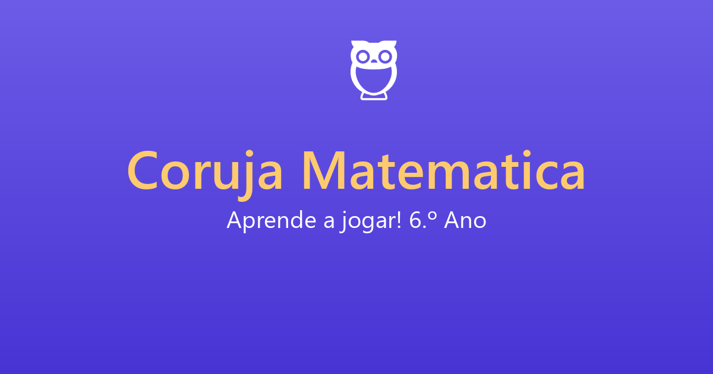

# 🦉 Coruja Matemática

> **Aprende matemática do 6.º ano a jogar.** Um jogo educativo que combina desafios de matemática com uma arena de física interativa.

[](https://vitejs.dev/)
[](https://www.typescriptlang.org/)
[](https://phaser.io/)
[]()

### 🎮 [**Jogar Agora (Versão Web)**](https://zimous12m-tech.github.io/coruja-da-matematica/)



## ✨ Funcionalidades

O **Coruja Matemática** foi desenhado para ser viciante, acessível e pedagogicamente sólido.

- **6 Mundos Temáticos:** Explora temas como Frações, Geometria, Percentagens e Lógica.
- **360 Exercícios Reais:** Gerados dinamicamente com distratores pedagógicos (erros típicos de aluno).
- **36 Níveis + Bosses:** Cada mundo termina com um desafio de "Boss" cronometrado.
- **Arena de Física:** Usa a coruja para saltar entre plataformas e apanhar a resposta certa! (Inclui modo acessível só com botões).
- **4 Idiomas:** Português (PT/BR), Inglês e Espanhol.
- **Zona dos Pais:** Protegida por um *gate* matemático, com relatório de progresso e controlo de dados (RGPD/COPPA compliant).
- **Acessibilidade:** Fonte para dislexia, alto contraste, redução de movimento e navegação por teclado.
- **Save Automático:** O progresso fica guardado localmente (localStorage).

## 🛠️ Stack Tecnológica

- **Core:** [Vite](https://vitejs.dev/) + [TypeScript](https://www.typescriptlang.org/) (Strict Mode)
- **Motor de Jogo:** [Phaser 3](https://phaser.io/) (Matter.js para a física)
- **Validação de Dados:** [Zod](https://zod.dev/)
- **Internacionalização:** [i18next](https://www.i18next.com/)
- **PWA:** Instalável em telemóvel e desktop.

## 🚀 Como correr o projeto localmente

Precisas do **Node.js 20+** instalado.

```bash
# 1. Clonar o repositório
git clone https://github.com/zimous12m-tech/coruja-da-matematica.git
cd coruja-da-matematica

# 2. Instalar as dependências
npm install

# 3. Gerar os 360 exercícios (JSON)
npm run content:build

# 4. Iniciar o servidor de desenvolvimento
npm run dev
